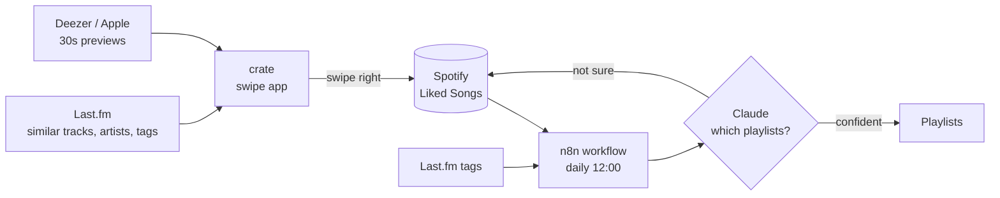

# crate

Swipe to discover music, and let a workflow file what you keep into the right playlists.

I had 800 liked songs on Spotify and no playlists I actually used. I also kept listening to the same handful of artists. This project is the two tools I built to fix both problems:

1. **crate**, a small web app. It plays 30-second previews of songs I have not saved yet. Swipe right to save, left to never see it again, up to also add it to my `replay` playlist.
2. **Auto Playlist Sorter**, an n8n workflow. Every day at noon it looks at the songs I liked in the last day and adds each one to the playlists it fits.

The two only meet in Spotify's Liked Songs: the app writes to it, the workflow reads from it.



## The swipe app (`docs/`)

One static HTML file, no build step, no server. Try it: enable GitHub Pages on this repo (Settings → Pages → Deploy from branch → `main` / `docs`) and open the page. **Try the demo deck** works without any accounts.

What a card shows: the song, the artist, why it was suggested ("because you saved X"), and the top Last.fm tags. Seeing the tags on every card is the point. After a few dozen swipes the **taste** screen tells you which tags you keep saying yes to, which is how I learned what to call the music I like.

Where cards come from:

| Source | How |
|---|---|
| mix | Songs similar to a random liked song, new artists near my liked artists, and tags I keep liking |
| for *a playlist* | Artists similar to that playlist's anchor artists, and that playlist's tags |

To use it with your own Spotify:

1. Create an app at [developer.spotify.com/dashboard](https://developer.spotify.com/dashboard). Development mode needs Spotify Premium.
2. Add your GitHub Pages URL as a Redirect URI (the app's setup screen shows the exact value).
3. Get a free Last.fm API key at [last.fm/api/account/create](https://www.last.fm/api/account/create).
4. Paste the Client ID and the Last.fm key into the setup screen and connect.

Login uses the PKCE flow, so there is no client secret anywhere. Keys and tokens stay in the browser's local storage.

## The taste card (`docs/taste.json`)

Each playlist is one entry: a one-sentence rule, three anchor artists, a few tags, and what stays out. Writing these down was the hardest and most useful part. The app reads this file to build per-playlist decks; the workflow's prompt says the same thing in prose.

```json
{
  "id": "good_stuff",
  "name": "the good stuff",
  "rule": "Funk, soul, indie and indie dance with a warm groove. A bit niche, never generic.",
  "anchors": ["Jungle", "Rikas", "Parcels"],
  "tags": ["funk", "soul", "nu disco", "indie pop", "neo soul"],
  "exclude": "House and techno, pop rock"
}
```

## The n8n workflow (`n8n/auto-playlist-sorter.json`)

Ten nodes:

1. **Daily 12:00**: schedule trigger.
2. **Get liked songs**: last 50 liked songs.
3. **Pick new songs**: keeps only songs liked in the last 26 hours.
4. **Skip already processed**: so a song is never sorted twice.
5. **Last.fm tags**: listener tags for the song. This is the main evidence.
6. **Spotify artist genres**: supporting evidence, often empty.
7. **Build prompt**: song, artist, album, year, tags.
8. **Classify with Claude**: returns playlists with a confidence from 0 to 1.
9. **Decide playlists**: keeps matches with confidence 0.75 or higher.
10. **Add to playlist**: one song can go to several playlists.

If the model is not sure, nothing happens and the song just stays in Liked Songs. I preferred a missing song over a wrong one.

To run it: import the JSON into n8n, connect a Spotify OAuth2 credential, a Query Auth credential named `api_key` holding your Last.fm key, and an Anthropic credential. Replace the six `YOUR_PLAYLIST_ID_n` values in **Decide playlists** and rewrite the playlist descriptions in **Classify with Claude** to match your own. The self-hosted Community edition of n8n is free (`npx n8n`).

## What broke along the way

Spotify changed its Web API for small apps in November 2024 and again in February 2026. Most tutorials are out of date. The things that cost me time:

- **Adding songs to a playlist returned 403.** `POST /playlists/{id}/tracks` was replaced by `/playlists/{id}/items`. n8n's built-in Spotify node still calls the old path, so the workflow uses an HTTP Request node instead.
- **Saving a song.** `PUT /me/tracks` is gone. Everything (tracks, artists to follow) goes through `PUT /me/library?uris=`.
- **No audio features, no recommendations, no previews.** Tempo and energy data, the recommendations endpoint and `preview_url` are not available to new apps. Classification uses Last.fm tags plus an LLM instead, recommendations come from Last.fm, and previews come from Deezer with Apple's iTunes Search as a fallback.
- **Search returns at most 10 results**, and development mode apps are limited to five users. This is a personal tool, not a product.

## Limits

- Classification is a judgment by a language model on text evidence. It never hears the song. It is wrong sometimes, mostly on new or niche songs with no tags.
- Last.fm's similar-artist data leans towards popular artists.
- Preview matching is by artist and title. A live or remastered version sometimes plays instead of the original.

## Roadmap

- The sorter as a scheduled GitHub Actions script, so it runs without n8n.
- A weekly "new this week" playlist built from the same sources as the app.

Built by [Ilgın Deniz Kuran](https://github.com/ilgindenizkuran-rgb), with Claude as a pair programmer. MIT licensed.
